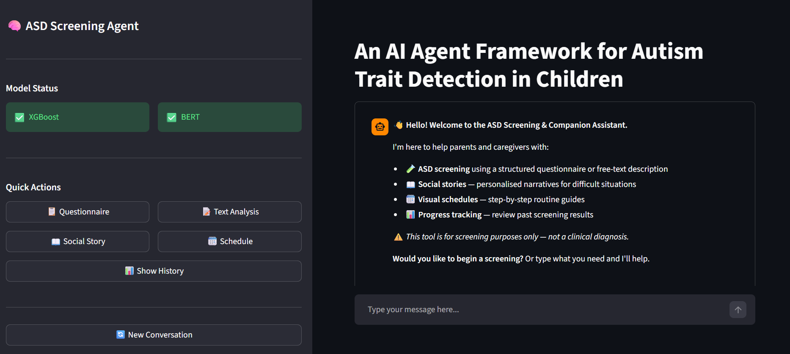
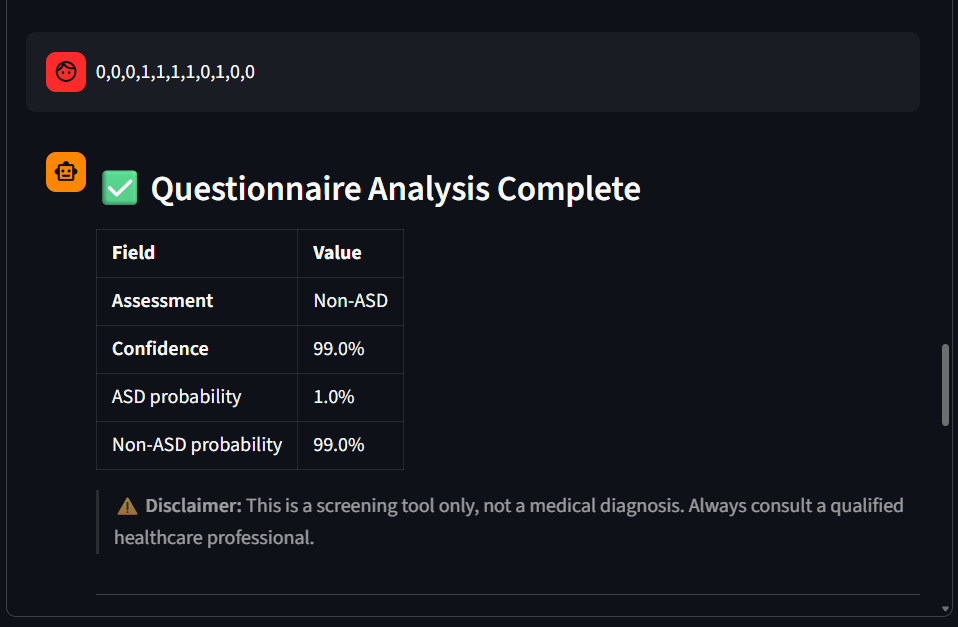
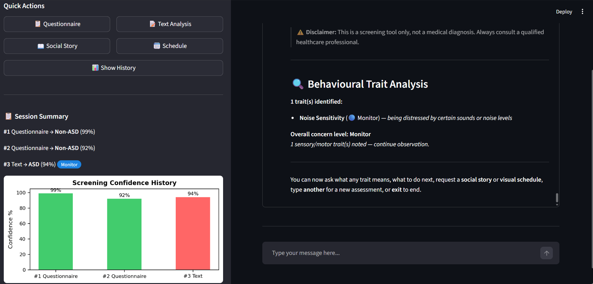
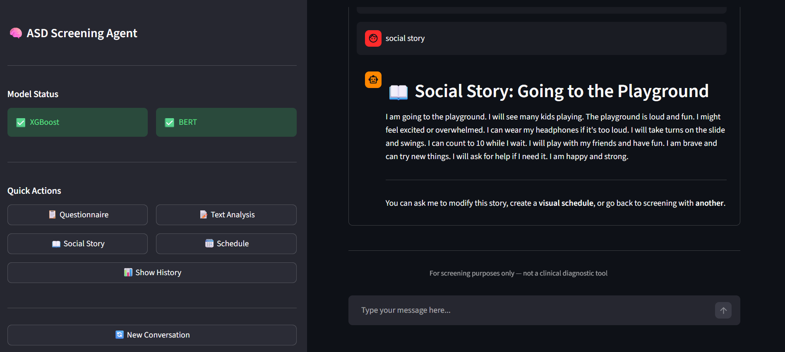
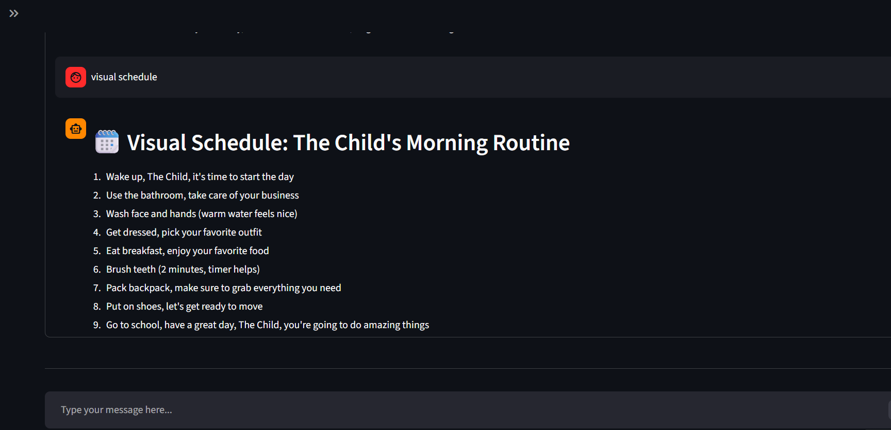

# An AI Agent Framework for Autism Behavioral Trait Detection in Children

**Capstone project | Computer Science & Engineering | East West University**

## Project overview

The project describes a dual-input workflow for child behavioural-trait screening research:

1. **Structured questionnaire path:** an XGBoost model trained on Q-CHAT-10-derived binary features compared with Random Forest, K-Nearest Neighbours (KNN) and Logistic Regression.
2. **Free-text path:** a fine-tuned `bert-base-uncased` classifier for ASD/Non-ASD labels on a small behavioural text dataset. The notebook uses synonym and contextual BERT masked-language-model augmentation on the training set.
3. **Agent experience:** a LangGraph workflow with supervisor, questionnaire, text, guidance, social-story, and visual-schedule agents; a fixed 14-trait taxonomy; and a Streamlit interface.

The project builds an end-to-end Streamlit interface and a LangGraph `StateGraph` with six agent roles: supervisor, questionnaire, text analysis, guidance, social story, and visual schedule. It also discusses memory/session history, a fixed 14-trait list, a concern tier, and FAISS-backed template retrieval.
See Screenshots of the application in [assests/app-screenshots](assests/app-screenshots).

## Model Results

| Task | Model | Test accuracy | Macro precision | Macro recall | Macro F1 | AUC-ROC | Additional result |
|---|---|---:|---:|---:|---:|---:|---|
| Q-CHAT-10 structured | XGBoost | 98.58% | 0.9779 | 0.9897 | 0.9835 | 0.9997 | 5-fold CV accuracy: 0.9763 ± 0.0135 |
| Behavioural free text | Fine-tuned BERT | 88.00% | 0.8917 | 0.8766 | 0.8782 | 0.9792 | 95% Wilson CI for accuracy: [0.7619, 0.9438]; test n=50 |

The tabular notebook evaluates four models on an 80/20 stratified split of 1,054 records (843 train, 211 test). The text notebook cleans the supplied 333-row CSV to 332 records and uses a 70/15/15 stratified split (232 train, 50 validation, 50 test). Full metric details are documented in [`RESULTS.md`](RESULTS.md).

## Screenshots from the app

| Questionnaire result | Behavioural trait analysis |
|---|---|
|  |  |

| Social story example | Visual schedule example |
|---|---|
|  |  |

More screenshots are available in [`assets/app-screenshots/`](assests/app-screenshots).

## Dataset

The project works with two public datasets.

**1. Toddler Autism Screening / Q-CHAT-10-derived tabular data**

- Dataset page linked in the notebook: [Kaggle — Autism Screening for Toddlers](https://www.kaggle.com/datasets/fabdelja/autism-screening-for-toddlers)
- Source data includes 1,054 records and fields such as A1–A10, age in months, sex, ethnicity, jaundice, family history, respondent, Q-CHAT-10 score, and `Class/ASD Traits`.
- The notebook excludes `Case_No` and `Qchat-10-Score` from model features. It uses A1–A10 plus sex.

**2. ASD Behavioural Text Dataset**

- Dataset page linked in the notebook: [Mendeley Data — ASD Behavioural Text Dataset, version 2](https://data.mendeley.com/datasets/87s2br3ptb/2)
- The source notebook shows 333 raw rows with `Text`, `Class`, `Sign`, and `ASD`; one malformed row is removed, resulting in 332 records.

## Research and generalisation limitations

- The text dataset is small (332 rows; 50 held-out test samples) reflected in the broad 95% Wilson interval. Results may vary materially with another split or dataset.
- The text model is evaluated on a random split from the same source dataset, not an independent institution, cohort, language, or prospective study.
- Text augmentation can change meaning despite protected vocabulary and filtering; its clinical fidelity was not independently evaluated.
- The 14-trait extraction uses a constrained LLM call and there are no sentence-level ground-truth multi-label annotations for reliable trait-wise evaluation.
- The concern tiers are a project design, not a clinically validated severity scale.
- The structured model uses public data labels; high retrospective accuracy does not make the model a diagnostic instrument.

